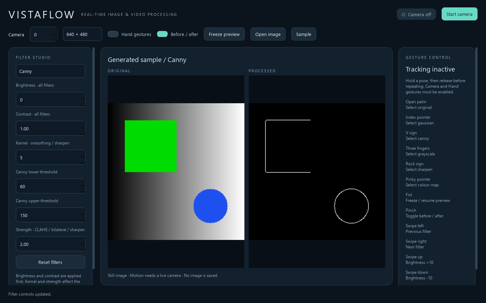

# VistaFlow
## Real-Time Image & Video Processing — temporary edition

A separate, focused edition derived from F.R.I.D.A.Y. for short-term use. The complete
F.R.I.D.A.Y. application remains in `E:/FRIDAY`, unchanged. This folder has its own code,
configuration, tests and copied hand model. It does not load parent-project source or
write parent settings. No voice assistant, Air Canvas or media player is included.
Dino is also left in the full project so this edition stays focused on image/video work.



## Run now on this computer

Double-click **launch.cmd** in this folder. It uses this folder's `.venv` if present,
otherwise the existing `E:/FRIDAY/.venv` interpreter/libraries. The source code loaded is
VistaFlow's own. No package installation or changes to F.R.I.D.A.Y. are needed for this path.

From PowerShell, run:

```powershell
cd E:/FRIDAY/temporary/VistaFlow
.\launch.cmd
```

To use the full project again, close VistaFlow and run `E:/FRIDAY/main.py` with the
original environment as before. Use only one application with the same camera at a time.
Both projects can remain on disk; no rollback or replacement is necessary.

## Install independently elsewhere

Extract the supplied ZIP into a separate folder. Use Python 3.12 (verified: 3.12.8).
Create a private environment here; do not install this distribution into the full
F.R.I.D.A.Y. environment because the copied packages share top-level module names.

```powershell
py -3.12 -m venv .venv
.venv/Scripts/python -m pip install -r requirements.txt
.venv/Scripts/python main.py
```

Dependencies are NumPy, OpenCV contrib, SciPy, PySide6 and optional MediaPipe, plus pytest/Ruff
for development. The supplied requirements pin the runtime versions used here. No Whisper,
ElevenLabs, assistant, Qt media-player or Pygame functionality is used. MediaPipe itself
declares transitive dependencies including sounddevice; VistaFlow never captures microphone
audio or uses speech processing. For filters without gestures, MediaPipe can be omitted.

A copied `data/hand_landmarker.task` is included locally/in the ZIP. If missing, filters
still work; download the checksum-verified hand model explicitly with:

```powershell
.venv/Scripts/python -m experiments.setup_model
```

Startup never downloads models or activates a camera. No API key is needed.

## What changed

- Rebranded and isolated as **VistaFlow**. The original assistant stays intact.
- Removed voice/microphone/TTS workflows, Canvas objects/drawing, media playback and
  their navigation, configuration and application imports.
- Retained the original academic enhancement, filtering, histograms, frequency processing,
  transforms, morphology, edges, segmentation, colour and motion implementations.
- Added a live filter adapter: brightness/contrast preprocessing, adjustable Gaussian/mean/
  median kernels, configurable Canny thresholds, adjustable unsharp masking, CLAHE,
  bilateral smoothing, grayscale and Turbo colour mapping.
- 29 single-frame filter choices plus live motion analysis. Original/processed views
  use the same source frame. Camera and image processing run off the UI thread.
- Eight recognized static poses, up from four, plus four directional swipes. Temporal
  hold/release, smoothing, pinch hysteresis, cooldown and tracking-loss handling remain.
- Open a local image, use a clearly labeled generated sample, or start a real webcam.
  Freeze only the preview; camera/tracking continue so gestures can resume it.

## Controls

1. Start with the generated sample and select filters in **Filter studio**.
2. Adjust brightness/contrast for any filter. Kernel affects mean, Gaussian, median,
   bilateral and sharpening. Strength affects CLAHE, bilateral and sharpening. Canny
   requires lower threshold < upper threshold. Invalid values are rejected, not silently used.
3. Choose camera index/resolution, then **Start camera**. Changes to device/resolution
   are disabled while running. Stop releases the device. Open image is available when stopped.
4. **Before / after** toggles the paired original view. **Freeze preview** holds the
   displayed images but continues processing; Resume shows the current result.
5. Enable **Hand gestures** while camera is active. Mouse controls work without tracking.
   Diagnostics exposes candidate, confidence, hold/cooldown and handedness.
6. Keyboard: Space freezes/resumes, Left/Right changes filter, R resets filter parameters.
   A focused spin box may consume arrow keys; click the preview for global shortcuts.

Filter note: brightness/contrast preprocessing precedes the selected operation. The
Original option displays that adjusted image; **Reset filters** restores true neutral
original output. The left comparison image always remains unadjusted. Live mean and
sharpen use parameterized OpenCV paths; the copied custom academic functions remain
available for study and regression tests. DCT/Haar/FFT displays are normalized coefficient
views, not reconstructed photographs. Haar requires even input dimensions. Motion uses
consecutive live frames and reports global phase-correlation displacement; a still image
cannot supply motion information.

## Gestures and mapping

| Pose/motion | Action |
|---|---|
| Open palm | Original filter |
| Fist | Freeze/resume preview |
| Pinch thumb/index | Toggle before/after |
| Index finger only | Gaussian filter |
| Index + middle extended (V sign) — new | Canny edges |
| Index + middle + ring extended — new | Grayscale |
| Index + pinky extended (rock sign) — new | Sharpen |
| Pinky only — new | Colour map |
| Open-palm swipe left/right | Previous/next filter |
| Open-palm swipe up/down | Brightness +10/-10 |

Directions follow the displayed **unmirrored camera image**. Opening a palm first selects
Original; hold it steady past confirmation/cooldown before swiping. Static actions fire
once per confirmed pose; release/change the pose before repeating. Default confirmation
requires 3 frames AND 120 ms, release 3 frames AND 80 ms, cooldown 350 ms and tracking-loss
grace 180 ms. New poses use palm-relative finger extension geometry, independent of hand
scale and tested for mirrored handedness. Face the palm toward the camera with visible
fingers. No gesture accuracy percentage is claimed; human trials are still required.

For tuning, copy/edit the local `config.example.json` and launch:

```powershell
.\launch.cmd --config config.example.json
```

The gesture profile exposes smoothing, hold/release, confidence, pinch hysteresis,
cooldown and swipe distance/velocity. Model paths resolve relative to the configuration
file. This edition neither reads nor writes F.R.I.D.A.Y.'s SQLite settings. Preferences
are session-local unless explicitly supplied through the local JSON file.

## Verification

113 automated tests passed, including all filter choices, eight pose fixtures, hand
scale/mirror invariance, temporal rearming, swipe direction, pinch hysteresis, gesture
routing, invalid settings, copied academic regressions, exact frame pairing, missing-model
isolation, Qt controls and image loading/failure. An isolation run disables original
editable-package fallback and checks every loaded project module belongs to this folder.
Native startup, Ruff and rendered layouts at 1380×860 and 1080×720 were checked.

Using the environment available to you (replace `.venv/Scripts/python` with
`../../.venv/Scripts/python` when reusing the original interpreter):

```powershell
.venv/Scripts/python -I experiments/verify.py
.venv/Scripts/python -m ruff check .
.venv/Scripts/python -m ruff format --check .
.venv/Scripts/python main.py --smoke
.venv/Scripts/python -m experiments.benchmark
# Explicitly activates the camera for a bounded 60-frame timing run:
.venv/Scripts/python -m experiments.benchmark --camera
```

Observed camera + hand tracking + Canny run: 60 frames, requested 640×480/30 FPS,
**21.46 median processed FPS**, clean worker/device release, no frames saved. This is
not a recognition accuracy test, a sustained-load test or a 30 FPS guarantee. Synthetic
filter timings and exact machine/workload details are in `docs/evidence/filters.json`.
See [change and verification report](docs/CHANGES.md).

## Short demo and remaining manual checks

Show the sample, compare Gaussian/Canny/CLAHE, tune controls, then start camera and
turn on Hand gestures. Demonstrate the new V-sign, three-finger and rock-sign mappings,
then pinch comparison and fist freeze. Release each pose before repeating. Stop camera.

Before presenting, test all eight poses and four swipes on both hands, with your lighting,
background and camera. Record missed/false events instead of trusting the geometry score
as an accuracy estimate. Test gestures held for five seconds (no repeated toggles), brief
occlusion, close/reopen camera, and native DPI/focus. The new poses are synthetic-tested;
physical gesture usability has not been signed off. No camera frames, microphone audio
or user-loaded images are persisted by default. Experiment images are generated fixtures.
