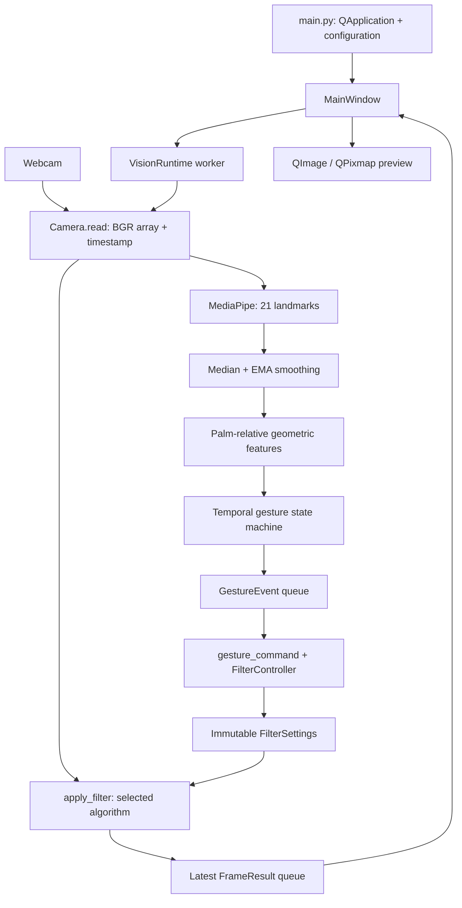

# VistaFlow: code, algorithms, architecture and viva study guide

Prepared from the submitted `VistaFlow_Temporary.zip` and its matching extracted source, 29 September 2026. This guide describes what the code actually implements, including limitations. It does not alter the application, ZIP or original F.R.I.D.A.Y. project.

## 1. What you are presenting

**VistaFlow — Real-Time Image & Video Processing** is a Python desktop application. It accepts webcam frames or a still image, applies classical image-processing operations, displays original/processed views and lets hand gestures select filters or control the preview. The temporary edition excludes voice, Air Canvas, media and Dino. It is not the complete original F.R.I.D.A.Y. SRS implementation.

There are two distinct uses of computation:

- **Image processing:** NumPy, OpenCV and SciPy implement mathematical transformations of pixel arrays. Several academic algorithms have explicit NumPy implementations; others use library implementations.
- **Gesture interaction:** a pretrained MediaPipe model estimates hand landmarks. Project code then performs smoothing, geometric feature extraction and temporal confirmation to classify a controlled gesture vocabulary. VistaFlow does not train that landmark model, and it does not use an LLM for filters or gestures.

A good introductory explanation is: “My application separates acquisition, processing, gesture interpretation, command routing and presentation. The image-processing engine is the academic core. Gestures provide an alternative input method for that engine.”

## 2. Architecture and the complete journey of a frame



The interface starts without silently opening the camera. Starting the camera creates a background worker. Every iteration reads a frame, optionally tracks hands on the original frame, applies the selected filter, records timings and publishes a preview packet. The UI periodically consumes packets and gesture events. A confirmed gesture becomes a normalized command, changes controller state, and affects subsequent frames.

There are three execution contexts:

| Context | Responsibility | Why it is separate |
|---|---|---|
| Qt main thread | Widgets, input, timers, drawing | Qt widgets belong on the GUI thread |
| Camera worker thread | Capture, tracking, filters, metrics | Device calls and processing must not freeze controls |
| Single-worker executor | Still-image loading/filtering | Large images and decoding must not block the GUI |

Gesture recognition never reaches into a widget. It reports what happened; `core/control.py` decides what that means for this application.

## 3. Python concepts you must understand

| Construct in this project | Meaning and purpose |
|---|---|
| `@dataclass` | Generates ordinary data-object methods such as initialization and representation |
| `frozen=True` | Prevents assigning fields after construction; it does not deeply freeze a contained dictionary or array |
| `field(default_factory=dict)` | Creates a separate dictionary for each instance, avoiding shared mutable defaults |
| Type hints | Document expected types and help tools; runtime validation still needs explicit checks |
| `dataclasses.replace(settings, ...)` | Builds a new validated settings object with selected fields changed |
| `with Camera(...)` | Calls context-manager methods and releases the camera when the block exits, including on exceptions |
| `try/except/finally` | Separates recoverable failure handling from unconditional resource cleanup |
| `deque` | Efficient bounded or time-window history for smoothing and motion |
| `Queue` | Thread-safe transfer of results/events between worker and GUI |
| `Event` | Cooperative stop signal; not the same concept as a recognized GestureEvent |
| `Future` | A handle to background work; the UI checks completion before fetching a result |
| Callback/signal connection | A function registered to run when a UI action occurs |
| `lambda ..., n=name` | Captures the current loop value, avoiding Python's late-binding closure problem |
| `functools.partial` | Creates an operation with a method argument already supplied |
| `if __name__ == '__main__'` | Runs the entry point when executed directly, without starting the app on import |

A thread improves responsiveness; it does not guarantee that all Python loops run in parallel. Much of OpenCV/NumPy processing executes in native libraries. Sharing data still requires care.

## 4. Startup, configuration and packaging

### main.py and launch.cmd

`launch.cmd` changes to its own folder, uses a local `.venv` if available, otherwise uses the parent project's interpreter, and forwards arguments to `main.py`. It does not install dependencies.

`main()` parses `--config` and `--smoke`, imports Qt, creates `QApplication`, loads configuration, creates/shows `MainWindow` and enters `app.exec()`. The Qt event loop dispatches events, timer callbacks and repaint requests. Smoke mode schedules a close after approximately 700 ms; successful smoke startup is not proof of live recognition accuracy.

### core/config.py

`GestureConfig` and `Config` are frozen dataclasses. Nested JSON gesture settings become a `GestureConfig`. Validation rejects invalid numeric values, unsuitable counts and inconsistent thresholds. For example, pinch exit must exceed pinch entry. A relative model path in a configuration file resolves relative to that file, not whichever terminal directory happens to be active.

Key defaults:

| Setting | Default | Tradeoff |
|---|---:|---|
| Median window | 3 observations | Suppresses short outliers; adds lag |
| EMA alpha | 0.45 | Larger follows faster; smaller smooths more |
| Hold frames / duration | 3 / 120 ms | Both must pass before activation |
| Release frames / duration | 3 / 80 ms | Both must pass before release |
| Pinch entry / exit | 0.30 / 0.43 palm-relative units | Hysteresis prevents threshold chatter |
| Minimum confidence | 0.70 | A heuristic quality gate, not measured accuracy |
| Finger extension ratio | 1.15 | Tip distance must sufficiently exceed joint distance |
| Cooldown | 350 ms | Limits successive emitted actions |
| Tracking-loss grace | 180 ms | Tolerates brief disappearance |
| Swipe distance / velocity | 0.20 / 0.55 per second | Requires deliberate displacement and speed |
| Swipe history window | 500 ms | Limits the temporal interval considered |

Camera settings request index 0, 640×480, 30 FPS. A device may negotiate different values or deliver slower frames. Requesting 30 FPS does not prove 30 FPS performance.

### Other root files

`pyproject.toml` defines package metadata, Python compatibility, dependencies and test/lint settings. `requirements.txt` supplies the tested dependency versions. `config.example.json` demonstrates runtime configuration. Package `__init__.py` files mark importable packages. `.gitignore` excludes unsuitable generated/local files. The `.task` file is a pretrained binary hand model, not Python source written or trained by this project. Documentation and preservation manifests are evidence, not runtime application logic.

## 5. Images, cameras and memory

A typical webcam frame is a NumPy array of shape `(height, width, 3)` and dtype `uint8`. Each channel is an integer from 0 to 255. OpenCV convention is **BGR**, while Qt's chosen display format uses **RGB**. A grayscale image has shape `(height, width)`.

For a 640×480 BGR image, raw pixel storage is 640×480×3 = 921,600 bytes. Copies improve ownership/isolation but cost memory bandwidth. Do not confuse the spatial array axes `(row, column)` with drawing coordinates `(x, y)`.

Arithmetic must promote before operations that could overflow. For brightness, `uint8` addition can wrap; conversion to float, calculation, clipping and conversion back prevent that.

### vision/camera.py

`Frame` groups the image, timestamp and measured acquisition cadence, with width/height derived from the actual array. `Camera.open()` releases an old capture, opens the selected device, checks success and requests settings. `read()` verifies that capture succeeds and timestamps the result using a monotonic performance clock. `close()` releases the device. Context-manager methods provide reliable cleanup.

The reported camera FPS is `1 / time_between_completed_reads`. It includes the effect of other worker work and pacing between reads. It is not an isolated measurement of the camera's maximum hardware rate.

`vision/preview.py` is a separate minimal OpenCV preview utility, not the Qt application's main entry point.

## 6. The filter adapter used by the live application

`vision/live_filters.py` contains `FilterSettings`, `apply_filter()` and `load_image()`. The operation list includes **29 single-frame choices plus motion**.

`FilterSettings` validates the selected operation, brightness/contrast, odd kernel size, ordered Canny thresholds and strength. Invalid settings cannot replace valid controller state. The odd kernel is constrained to 3–15. Contrast is 0.2–3, brightness −100–100 and strength 0.1–8.

`apply_filter()` first applies global brightness and contrast:

    output = clip(contrast × input + brightness, 0, 255)

With contrast 1.2 and brightness 15, input 100 becomes 135; input 240 becomes 255 after clipping. It then dispatches the selected operation. Thus “Original” still includes current brightness/contrast adjustments. Reset restores those adjustments as well as the default filter.

The current UI selects one main operation at a time; it is not an arbitrary user-configurable chain. Some named operations internally contain several steps.

### Parameterized operations

- **Mean:** OpenCV box filtering replaces each pixel with the neighborhood mean. It reduces noise and blurs edges.
- **Gaussian:** weighted smoothing, with center pixels contributing more. The live call lets OpenCV derive sigma from the selected kernel. The academic helper has a different fixed default sigma.
- **Median:** the neighborhood median suppresses isolated salt-and-pepper noise while often preserving edges better than a mean.
- **Sharpen:** unsharp masking: `result = (1 + strength) × image − strength × blurred_image`, then library saturation. It boosts high-frequency detail and can amplify noise/halos.
- **Canny:** grayscale input, configurable lower/upper thresholds. The live branch does not explicitly add a separate Gaussian preprocessing stage, and its kernel control is not passed to Canny. OpenCV defaults are used for other parameters, including L1 gradient magnitude unless L2 is requested. See [OpenCV Canny documentation](https://docs.opencv.org/4.13.0/da/d22/tutorial_py_canny.html).
- **CLAHE:** limits local histogram amplification; on color input it modifies Lab lightness, then converts back. `(8, 8)` is the number of tiles along each axis, not an 8×8-pixel tile size.
- **Bilateral:** combines spatial proximity with intensity similarity. It can smooth flat regions while preserving edges, at greater computational cost. Strength influences the range/spatial sigmas.
- **Grayscale:** converts color channels to luminance-like intensity; this loses chromatic information.
- **Turbo colour map:** maps intensity to display colors. It does not estimate temperature, depth or semantics.
- **Motion:** the single-frame adapter supplies a base image; temporal displacement is computed in the runtime using consecutive frames.

Remaining names dispatch through the academic operation registry. The adjustable kernel/strength controls do not automatically alter every academic function: inspect the branch to know which parameters apply.

`load_image()` reads bytes with `np.fromfile` and decodes using `cv2.imdecode`, supporting Windows Unicode paths. Decode failure raises an error. Loading is not recording or saving camera input.

## 7. Academic image-processing modules: understand the mathematics

These preserved modules are reusable and tested separately. Distinguish them from the parameterized adapter: the live mean and sharpen branches do not execute the custom NumPy mean/fixed-kernel sharpening implementations.

### vision/preprocessing.py

`gray()` returns grayscale, copying an already grayscale input. `resize()` validates positive dimensions and uses area interpolation. `normalize()` converts to float32 and divides by 255. These are utilities; the entire runtime does not automatically normalize every frame to 0–1.

### vision/filtering.py: correlation and spatial filters

`correlate()` validates an odd-sized kernel, handles color by processing each channel, pads with reflected pixels and uses sliding windows plus `einsum` to calculate weighted sums.

    output[y, x] = sum over i,j of padded_image[y+i, x+j] × kernel[i,j]

This is **correlation**, because the kernel is not reversed. True convolution flips the kernel along both axes. They agree for symmetric kernels, but derivative signs can differ for asymmetric kernels. OpenCV `filter2D` is also a correlation reference here. A test's colloquial use of “convolution” should not override the actual implementation.

`sliding_window_view` exposes overlapping neighborhoods as a view; the reduction computes the output. It does not eliminate the work of visiting all kernel elements. For an H×W image and k×k kernel, straightforward filtering is roughly O(HWk²) per channel. The view avoids explicitly creating every window as an independent copy, although downstream operations and padding still require memory. See [NumPy window-view documentation](https://numpy.org/doc/stable/reference/generated/numpy.lib.stride_tricks.sliding_window_view.html).

A 3×3 mean kernel contains nine values of 1/9. If a neighborhood contains eight zeros and one 90, the mean is 10. `smooth()` builds the normalized kernel and clips to uint8. `sharpen()` uses the fixed kernel below:

    0  -1   0
   -1   5  -1
    0  -1   0

Its sum is 1, so constant interiors are preserved while local differences are emphasized. `gaussian()` and `median()` are library-backed helpers. The default academic Gaussian uses size 5 and sigma 1; do not confuse it with the live Gaussian's automatic sigma.

### vision/enhancement.py: histogram equalization

`adjust()` performs linear intensity adjustment. `histogram()` counts grayscale values using `np.bincount` with 256 bins. The histogram's total equals the number of pixels.

`equalize()` calculates the cumulative distribution function (CDF), identifies its first nonzero value and constructs a lookup table:

    LUT[v] = round((CDF[v] − CDF_min) × 255 / (N − CDF_min))
    result[y, x] = LUT[image[y, x]]

N is the pixel count. If all pixels have one value, the denominator becomes zero; the implementation returns the constant image unchanged. Global equalization redistributes intensity, while CLAHE adjusts local regions with contrast limiting. Neither method invents missing scene detail.

### vision/edges.py: gradients and boundaries

`gradients()` computes x/y derivatives using custom correlation. Sobel's horizontal derivative kernel is:

   -1   0   1
   -2   0   2
   -1   0   1

The transposed kernel estimates the other direction. Prewitt uses equal row weights instead of Sobel's 1,2,1 weighting. Sobel therefore includes more smoothing in the perpendicular direction.

`detect()` displays the gradient magnitude `sqrt(Gx² + Gy²)` for Sobel/Prewitt. Clipping to 255 makes a viewable image but discards larger numerical magnitudes. Laplacian estimates second derivatives using OpenCV and displays absolute scaled values. Canny uses the library implementation: gradient computation, suppression of non-maximal responses and threshold-based edge linking are distinct from simply thresholding a Sobel image.

Know the distinction: a gradient is a local rate of intensity change; an edge map is a decision/representation based on such changes.

### vision/morphology.py: structure-based processing

For a flat neighborhood:

- Erosion takes the minimum and shrinks bright regions.
- Dilation takes the maximum and grows bright regions.
- Opening performs erosion then dilation, removing small bright structures.
- Closing performs dilation then erosion, filling small dark gaps.

The custom implementation uses padded sliding windows and min/max reductions. Edge replication matches the selected OpenCV reference border policy. Grayscale morphology operates on intensities, so it is not restricted to binary images. A square structuring element determines which neighbors participate; its shape and size influence which details survive.

### vision/segmentation.py: threshold-based segmentation

`segment()` implements three methods:

- Global: a fixed threshold of 127 divides dark/light pixels.
- Otsu: OpenCV chooses a global threshold based on the histogram, equivalent to optimizing separation of two intensity classes.
- Adaptive: a local Gaussian-weighted neighborhood of size 11 determines the threshold, with C=2 subtracted.

Adaptive thresholding can handle uneven illumination better than one global threshold. Otsu is most convincing for suitable bimodal intensity distributions. These methods segment by intensity, not semantic understanding; they do not recognize “a person” or “a chair.”

### vision/color.py: color spaces and masks

`convert()` provides grayscale, HSV, Lab and RGB conversions. HSV separates hue, saturation and value. In OpenCV's standard 8-bit HSV representation, hue uses 0–179. `mask_hsv()` returns a binary in-range mask; its default range selects green-like colors. Lighting, white balance and shadows can change which pixels pass.

The current HSV operation displays HSV channel values through the generic image display path. Treat it as a channel-value visualization, not a natural-color HSV-to-BGR reconstruction. Other conversion helpers exist without all being separate UI choices.

### vision/transforms.py: frequency and transform processing

**FFT spectrum.** `spectrum()` computes a 2-D FFT, shifts low frequency to the center and displays `log(1 + magnitude)`. The logarithm compresses dynamic range, allowing weaker components to be seen. A bright center often indicates strong low-frequency content; directional patterns can reflect repeated structures.

**Ideal low-pass.** `lowpass()` creates a circular frequency mask of radius 20, removes higher frequencies and inverse-transforms. Lower frequencies represent broad variations; higher ones often correspond to sharp edges/noise. A hard cutoff may cause ringing. It is not equivalent to Gaussian smoothing.

**DCT.** `dct()` uses SciPy's orthonormal multidimensional DCT; `inverse_dct()` reconstructs the input. DCT represents information with cosine bases and often concentrates smooth-image energy in lower-frequency coefficients. This demonstrates a transform used in compression; it is not a complete JPEG encoder.

**Haar.** `haar()` explicitly combines adjacent values into averages and differences:

    low  = (a + b) / sqrt(2)
    high = (a − b) / sqrt(2)

It applies the operation across columns and rows, creating approximation and directional-detail bands. `inverse_haar()` reverses those operations. The implementation is one level and requires even dimensions. For `[2, 4]`, the coefficients are approximately `[4.243, −1.414]`; inversion returns `[2, 4]` within floating-point tolerance.

Do not confuse numerical coefficients with their preview: `display_image()` rescales non-uint8 output to display range. This can hide absolute magnitudes. For example, a constant low-pass result can be numerically correct while min-max display normalization makes a uniform dark image.

### vision/motion.py: two different motion approaches

**Block matching.** `block_match()` divides grayscale input into non-overlapping blocks and searches nearby positions in the next frame. The comparison is the mean absolute difference:

    error(dx, dy) = mean(abs(previous_block − candidate_block))

Although a local variable is named `sad`, the code takes a mean, not a sum. For fixed-size blocks, minimizing either chooses the same best displacement. Ties prefer smaller motion using an explicit deterministic ordering. The output is a set of `MotionVector` records: center, displacement and error.

Default block size is 8 and search radius is 4. Larger search radii detect larger displacements but cost more. Ignoring edge effects, candidate evaluations scale with `(2r+1)²`, giving roughly O(HW(2r+1)²) work. Incomplete blocks at trailing boundaries are not processed. Textureless regions are ambiguous, and motion outside the search range cannot be correctly recovered.

**Phase correlation.** `phase_translation()` calls OpenCV on grayscale float arrays to estimate one global `(dx, dy)` translation and a response value. Conceptually, image translation introduces a Fourier-domain phase relationship; a correlation peak reveals displacement. It assumes a dominant translation and does not independently estimate every object's motion.

**What the UI uses:** the live motion operation reports phase-correlation translation between consecutive frames. It does not render dense optical flow. `overlay()` can draw block vectors, and `TemporalMotion` wraps consecutive-frame handling, but the current runtime manages its own previous frame rather than using that wrapper.

### vision/operations.py: registry and display conversion

`OPERATIONS` maps names to callables. `partial` binds specific methods for shared edge/morphology/segmentation functions. This keeps dispatch extensible and testable. `synthetic_image()` generates a repeatable ramp/shapes sample. `histogram_plot()` draws a visual histogram scaled to the source size. `display_image()` leaves uint8 data unchanged and normalizes other numeric output for display.

A registry entry is an accessible algorithm, not proof that the entire live parameter adapter is identical to the academic reference function.

## 8. Hand tracking: what is learned and what is deterministic

### gesture/hand_tracking.py

`HandTracker.open()` loads the supplied MediaPipe model in VIDEO mode, configured for up to two hands. `detect()` converts BGR to RGB, wraps it as a MediaPipe image and calls `detect_for_video()` with a strictly increasing millisecond timestamp. Strict increase is enforced even if conversion from seconds would otherwise produce equal integer milliseconds.

The output includes 21 normalized landmarks per hand, handedness and its score. Index 0 is wrist; 4 thumb tip; 5 index MCP; 6 index PIP; 8 index tip; 9 middle MCP; 12 middle tip; 16 ring tip; 17 little-finger MCP; 20 little-finger tip. x/y are image-normalized positions; z is model-relative depth, not measured meters. See the [MediaPipe Hand Landmarker API](https://developers.google.com/edge/mediapipe/solutions/vision/hand_landmarker/python).

`Landmarks` validates a finite `(21, 3)` array, quality range and aspect ratio. Hand identity is assembled from handedness and occurrence index; it is not a guaranteed persistent identity under every crossing/occlusion.

`Smoother` retains recent observations per hand, calculates the coordinate-wise median and applies an exponential moving average:

    smoothed_t = alpha × median_t + (1 − alpha) × smoothed_previous

Median filtering rejects brief spikes; EMA reduces jitter. They also add delay. Missing IDs are removed from the smoother immediately. The recognizer's loss grace is separate, so preservation of recognition state does not imply preservation of all smoothing history.

`close()` releases the detector and resets state. Landmark drawing is optional diagnostics. The model is pretrained by MediaPipe; the project-written part begins with validation/smoothing and deterministic interpretation.

## 9. Geometric gesture features

### gesture/features.py: extract()

Raw image coordinates vary when the hand moves closer to the camera, rotates or changes location. `extract()` attempts to reduce that dependence:

1. Correct x and z using the frame aspect ratio.
2. Use wrist landmark 0 as the origin.
3. Use wrist-to-middle-MCP (landmark 9) distance as palm scale.
4. Construct a vertical axis along that vector.
5. Use index-MCP minus little-MCP as the lateral direction and remove its projection onto the vertical axis (Gram–Schmidt orthogonalization).
6. Normalize the lateral axis and obtain the third axis by a cross product.
7. Express centered landmarks in this basis and divide by palm scale.

In compact form, each normalized point is `(point − wrist) × basis / palm_scale`. Degenerate palms receive unusable quality instead of causing division by zero. A fallback axis handles a degenerate lateral estimate.

This improves translation/scale robustness and handles tested mirrored fixtures. It is not proof of accuracy under arbitrary camera perspective or severe occlusion.

The pinch feature is Euclidean thumb-tip/index-tip distance divided by palm scale. If distance is 12 units and palm scale 60, normalized pinch is 0.20 regardless of whether both sizes double.

Finger extension uses `distance(tip, wrist) / distance(PIP, wrist)` for index, middle, ring and little fingers. Ratios above 1.15 count as extended. This is a geometric approximation, not a complete joint-angle or anatomical model.

### classify(): eight static classes

Pinch has priority. Other poses depend on the four extension booleans:

| Index | Middle | Ring | Little | Classification |
|---|---|---|---|---|
| Extended | Extended | Extended | Extended | OPEN_PALM |
| Folded | Folded | Folded | Folded | FIST |
| Extended | Folded | Folded | Folded | INDEX_POINTER |
| Extended | Extended | Folded | Folded | V_SIGN |
| Extended | Extended | Extended | Folded | THREE_FINGERS |
| Extended | Folded | Folded | Extended | ROCK_SIGN |
| Folded | Folded | Folded | Extended | PINKY_POINTER |
| Any pattern meeting the pinch threshold first | — | — | — | PINCH |

Other patterns are UNKNOWN. A V sign is identified by this extension pattern; spread angle is not independently checked. Thumb extension is not an independent discriminator for the non-pinch classes.

The input quality value comes from MediaPipe's handedness category score. The code combines it with geometric margin to produce a gesture confidence heuristic. **This is neither a calibrated probability nor per-landmark certainty.** A 0.90 displayed score does not establish 90% recognition accuracy.

## 10. Temporal recognition: why a held pose emits only once

### gesture/gesture_recognition.py

`GestureEvent` records a name, confidence, timestamp and payload. The legacy `pose()` helper classifies one observation, but the active application uses `GestureRecognizer.update()` and its temporal state.

The recognizer stores the current candidate, active gesture, candidate start/count, release start/count, last emission time, hand identity and tracking state. It also records feature history; that history is not currently used as a majority-vote classifier.

Update logic:

1. Reject non-increasing timestamps.
2. Filter unusable hands and retain the active hand if still available.
3. If that hand disappears, keep state during a short grace interval; after the loss threshold reset and emit TRACKING_LOST.
4. Extract features and classify a candidate. A changed candidate starts a new hold; repeated candidates increase its count.
5. If a confirmed pose differs from the candidate, require enough differing frames AND elapsed release time before releasing it.
6. A candidate is stable only if it satisfies frame count, hold duration and confidence conditions.
7. Emit a new known pose only when there is no active pose and the cooldown has expired.
8. A held active pose does not repeatedly emit. Release/change is required to re-arm it.
9. While a confirmed open palm is present, feed wrist movement into swipe detection.

Conceptual states:

```text
No active pose -> Candidate -> Confirmed/active
                     |               |
               unstable/noisy    held: no repeat
                     |               |
                 new candidate <- release confirmed

Active hand missing -> brief occlusion grace -> tracking lost/reset
```

**Timing example:** observations at 0, 60 and 120 ms can satisfy three frames and 120 ms. At 30 FPS, frames at 0, 33 and 67 ms satisfy the frame count but not hold duration; confirmation requires later observations. Processing and smoothing add further delay. The configured hold time is not an end-to-end latency measurement.

### Hysteresis, release and cooldown are different

- Pinch entry below 0.30 establishes a new pinch candidate.
- When PINCH is already active, the wider 0.43 exit threshold tolerates some separation.
- Release confirmation prevents one noisy frame from ending a pose.
- Cooldown limits the rate of emitted events.

At a ratio of 0.36, an existing pinch may remain a pinch even though an inactive hand at 0.36 would not begin one. That is hysteresis: the threshold depends on state.

### gesture/swipe.py

`SwipeDetector` keeps recent timestamped wrist positions. It compares the oldest remaining point with the newest and computes displacement and velocity. A swipe needs sufficient travel, sufficient speed and limited off-axis motion. The history resets after successful recognition.

It supports LEFT, RIGHT, UP and DOWN. Positive image x is right; positive image y is down. The view is not a mirrored selfie view, so explain directions using the displayed image. The runtime only checks swipes during confirmed OPEN_PALM, suppressing arbitrary finger motion. Open-palm confirmation may first select Original before the subsequent swipe action.

Two hands can be detected, but this temporary recognizer selects one active hand. It does not implement two-hand scaling or rotation.

## 11. Normalized events, commands and application state

### core/models.py

`Command` contains intent, source, parameters and timestamp. `SystemEvent` is another general event contract. The models are frozen, but their dictionary contents are not deeply immutable.

An event reports observation: “V_SIGN recognized.” A command requests application behavior: “SET_FILTER to canny.” Keeping them separate allows the same recognizer to be reused without knowing application widgets.

### core/control.py

`gesture_command()` performs the application mapping:

| Gesture | Application command/result |
|---|---|
| OPEN_PALM | Original filter |
| INDEX_POINTER | Gaussian filter |
| V_SIGN | Canny edges |
| THREE_FINGERS | Grayscale |
| ROCK_SIGN | Sharpen |
| PINKY_POINTER | Colour map |
| FIST | Toggle preview freeze |
| PINCH | Toggle comparison |
| SWIPE_LEFT / SWIPE_RIGHT | Previous / next operation |
| SWIPE_UP / SWIPE_DOWN | Brightness +10 / −10 |
| Unknown or lifecycle event | No mapped filter command |

`FilterController.dispatch()` is a pure state transition boundary. It changes settings with `replace()`, steps filters with modular indexing, clamps brightness, toggles freeze/comparison, and rejects unknown commands. Because replacement validates before assignment, invalid input leaves the previous valid settings intact.

RESET restores default settings and unfreezes; it does not reset the comparison preference. Mouse/keyboard input also becomes Commands and uses the same controller.

### core/event_manager.py

The retained `EventManager` offers topic subscriptions, an unsubscribe closure and exception-isolated publication. The current VistaFlow UI does not instantiate it; its route is the direct gesture-to-command controller boundary described above. Do not present every retained helper as an active dependency.

## 12. Background processing and failure handling

### core/runtime.py

`FrameResult` contains processed image, events field, frame rate, processing time, optional original image and the settings snapshot used for that frame. Its iterable compatibility helper yields four fields, but the current UI uses attributes. Recognized gestures travel through a separate queue; the result's events field is not the active event transport.

`VisionRuntime` owns:

- a frame queue of capacity 1;
- an event/command queue of capacity 64;
- a message queue of capacity 32;
- a worker thread and stop event;
- tracker state, diagnostics, timing metrics and immutable settings snapshots.

`start()` clears stale queues/state and starts one worker. It avoids creating a duplicate worker while one is alive.

The worker's main loop:

```text
Open camera in a context manager
Create/reconfigure the tracker when tracking is enabled
Read a frame
Record processing start and snapshot settings
Detect hands on the raw frame -> update recognizer -> collect events
Apply selected image filter
If motion: compare current and previous raw frames, annotate displacement
Optionally overlay debug landmarks
Compute timing metrics
Queue events
Replace an old preview with the newest preview
Wait only for the remaining requested frame interval, interruptibly
Finally: close tracker and release camera
```

**Why a latest-frame queue?** If processing delivers faster than the UI paints, a long FIFO queue shows old frames and feels laggy. A capacity-one queue discards stale previews, favoring freshness. Gesture events use a separate bounded queue because dropping pictures and dropping control actions have different implications. Events can still be lost if that bounded queue overflows; messages report the condition.

**Why snapshot settings?** The user can change controls while a frame is being processed. Each packet carries the exact settings used, allowing the UI to reject an old packet after a new selection. The UI does not label an old Gaussian frame as a new Canny frame.

**Failure isolation:** an unavailable model disables tracking while image filtering continues. A tracking failure is reported and isolated. A filter failure reports feedback rather than pretending that its result is valid. Camera failure releases resources and returns the UI to usable still-image operation.

**Freeze:** this freezes preview presentation, not acquisition or recognition. That allows a later gesture to unfreeze it. It is therefore not a performance-saving pause.

**Stopping:** `stop()` sets the event; `close(timeout)` joins the worker up to the requested time. A blocked native camera call cannot be forcibly interrupted by the Python event. This is a genuine device/driver limitation.

**Thread-safety nuance:** queues are thread-safe and settings replacement avoids partially edited configuration. Some shared diagnostics/flags are updated by reference without a full locking protocol. This is a practical design for the tested CPython environment, not a claim that every shared object is deeply immutable or all conceivable interpreters are supported.

## 13. Qt interface: understand every MainWindow method

### ui/main_window.py

The window uses a left control panel, central comparison previews and a gesture/status panel. Reusable styles keep the presentation consistent. The constructor assembles widgets, creates the controller/runtime/executor, connects signals, prepares a synthetic sample and starts a 30 ms polling timer.

A QTimer schedules callbacks through the event loop; it is not a background processing thread, and busy work can delay a callback. This is why image work is delegated. See [Qt QTimer documentation](https://doc.qt.io/qtforpython-6/PySide6/QtCore/QTimer.html).

| Method | What it does | Important design point |
|---|---|---|
| `__init__` | Builds layouts, controls, shortcuts and processing objects | Setup is distinct from activating the camera |
| `scroll` | Wraps controls in a scroll area | Small windows can still reach controls |
| `dispatch` | Creates a Command from UI input | Mouse/keyboard shares the command boundary |
| `execute` | Dispatches, catches invalid input, synchronizes state and requests work | Failed validation restores the visible valid state |
| `sync` | Updates widgets and runtime settings from the controller | Blocks widget signals during programmatic updates |
| `set_tracking` | Changes the tracking request flag | Tracking does not independently start capture |
| `toggle_camera` | Starts/stops runtime using selected device/resolution | Camera settings are fixed for that active session |
| `open_image` | Uses a file dialog and schedules background decoding | Rejects overlapping loads and live-mode loading |
| `use_sample` | Restores the deterministic sample | Provides a hardware-independent demonstration |
| `pixmap` | Converts arrays to a Qt-owned display image | Correct channel order, row stride and ownership |
| `render` | Updates previews/caption unless frozen | Freeze affects presentation |
| `poll` | Collects finished work, packets, events, messages and metrics | Never waits for unfinished image Futures |
| `closeEvent` | Stops workers and waits cooperatively before final close | Avoids destroying resources while still in use |

**Why block signals?** Updating a spinbox programmatically can emit its value-change signal. Without blocking, reflecting controller state back into widgets can create redundant commands or loops.

**Why capture loop variables in lambdas?** Each parameter control must dispatch its own parameter name. Default-argument capture fixes the loop value at connection time; otherwise callbacks can all refer to the final loop variable.

**Image ownership:** `pixmap()` converts grayscale/BGR to RGB, ensures contiguous memory, supplies the actual row stride, constructs a QImage and calls `.copy()`. That copy detaches from the temporary NumPy buffer. Without ownership care, a Qt image could refer to memory whose lifetime has ended.

**Still-image scheduling:** when settings change, the window marks processing requested. It allows one submitted filter job at a time; the next job uses the newest requested settings. A result is shown only if both its settings and image identity still match current state. Rapid controls therefore coalesce pending work instead of creating an unlimited backlog.

**Gesture freshness:** `poll()` only accepts queued gestures while runtime is active, tracking is enabled and the event is younger than 0.5 seconds. This prevents old actions after a restart/stall. Mapping and dispatch occur on the GUI side, while recognition remains on the worker.

**Shutdown:** if a worker/Future is still busy, `closeEvent()` ignores that close request and schedules another check after 100 ms. Once work is finished, it stops the timer, shuts down the executor and accepts closure. It does not forcibly terminate a thread.

Keyboard fallback includes Space for freeze, Left/Right for operation selection and R for reset. Mouse controls remain available. Debug mode reveals candidate, score, hold, cooldown and state; normal mode uses readable labels.

### ui/components.py, theme.py and fonts.py

- `GlassPanel`: a reusable styled container with a content layout.
- `SectionHeader`: consistent title/subtitle treatment.
- `ModernButton`: shared button styling.
- `StatusChip`: label with active/inactive styling and a subtle timed pulse. That animation indicates state, not independently measured device health.
- `PreviewLabel`: custom aspect-preserving painting with letterboxing. Its sizing policy avoids a large pixmap forcing layout growth.
- `Notification` and `ValueCombo`: retained helper components, currently unused by MainWindow.
- `theme.py`: shared Qt stylesheet and a helper that converts internal labels to readable text. Styling does not perform vision logic.
- `fonts.py`: fallback font setup if the normal font database is unavailable. It does not download a font.

Glass-like styling is visual design; the app is a desktop image-processing interface, not actual AR projection or VR hardware.

## 14. Benchmarks and supporting scripts

### experiments/benchmark.py

The synthetic benchmark processes the repeatable 256×256 BGR sample with each of the 29 single-frame choices. Each receives two warmups and ten timed calls. `stats()` reports count, median and 95th percentile. Warmups reduce first-call setup influence but cannot remove every source of measurement variability.

Camera mode runs the runtime with Canny and tracking enabled, collects up to 60 frame metric summaries and attempts cleanup. Analysis drops ten warmup summaries, leaving 50. It writes timings/settings/environment metadata, not captured images.

Inspect `tracking_active` in the saved evidence: the script's overall camera success check is based on collecting frames and stopping cleanly, not proof of successful tracking. The supplied live evidence records tracking enabled.

### experiments/benchmarks.py

This separate reusable helper measures call duration and process CPU time, calculates median-based throughput, and can save rows to SQLite using parameterized SQL. CPU milliseconds are CPU time, not a percentage utilization reading. Its SQLite saving helper is not what the current `benchmark.py` uses for its JSON output.

### experiments/setup_model.py

An explicit setup utility downloads the model from its configured official location, checks the known SHA-256 and then writes it. The normal application does not silently download a model. A missing model is reported without removing basic filtering.

### experiments/verify.py

This runner puts the temporary project on its own import path and removes parent editable-install finder hooks before invoking pytest. That matters because both the original project and VistaFlow use package names such as `core` and `vision`. A test that accidentally imports the original implementation can pass while the submitted project is incomplete. Module-origin assertions detect this problem.

### Actual recorded results, not new measurements made for this guide

The delivery evidence reports 113 isolated tests passed in 5.47 seconds; Ruff and launch smoke passed. The following values come from the packaged benchmark evidence/report:

| Workload | Median | p95 | Interpretation |
|---|---:|---:|---|
| Acquisition cadence, live run | 22.70 FPS | 24.98 FPS | Worker-observed capture cadence |
| Processed rate, live Canny + tracking | 21.46 FPS | 21.67 FPS | Rolling completed-frame throughput |
| Live processing, excluding camera read | 42.03 ms | 57.18 ms | Tracking/filter/debug work; not display latency |
| Gaussian, 256×256 generated input | 1.313 ms | 1.362 ms | Short synthetic workload |
| Canny, same synthetic input | 1.629 ms | 1.772 ms | Same measurement scope |
| CLAHE, same synthetic input | 3.058 ms | 3.249 ms | Same measurement scope |
| Bilateral, same synthetic input | 2.193 ms | 2.414 ms | Same measurement scope |
| Colour map, same synthetic input | 1.867 ms | 2.016 ms | Same measurement scope |

The machine was Windows 11 build 26200 with Python 3.12.8. The live run requested 640×480 at 30 FPS; it did not achieve 30 processed FPS. The 60-frame run is short, not a sustained-performance guarantee. A p95 processing time describes the slow tail; a p95 FPS describes a high-throughput percentile and should not be mislabeled as worst-case speed.

No real-user recognition accuracy, false-positive rate or end-to-end gesture-to-screen latency was measured. Do not substitute 120 ms hold time or 42 ms processing time for those missing measurements.

## 15. Tests: what they establish

| Test file | Important checks | What it does not establish |
|---|---|---|
| `test_ivp.py` | Registry operations, input preservation, filtering reference comparisons, histogram/equalization, morphology, transform reconstruction, edges and masks | Every image or every numerical condition |
| `test_motion.py` | Known synthetic translation, deterministic static ties, temporal reset, benchmark persistence | Arbitrary real-world object tracking |
| `test_tracking.py` | Landmark validation, smoothing cleanup, missing model handling, model inference when available | Human gesture accuracy |
| `test_vistaflow.py` | Eight poses, mirrored/scale fixtures, hold/release, hysteresis, swipes, controller mapping, settings validation, runtime isolation and local imports | Complete real-camera robustness across people/environments |
| `test_desktop.py` | Actual Qt controls, compare/freeze/reset, missing camera behavior, worker loading/failure recovery and screenshots | Every display scaling, driver, focus and device scenario |

113 includes parameterized cases, not 113 independently named functions. For example, one test function can run once per filter or pose.

Understand **unit vs integration tests**: a pure geometry test isolates a mathematical rule; a controller test checks event meaning; a fake-camera runtime test checks module boundaries; a Qt test verifies actual widget behavior; a physical camera check adds device/model integration. Each answers a different question.

Reference comparisons should use matching border conventions, dtypes and scaling. Otherwise an apparent algorithm mismatch may actually be a difference in test setup.

This teaching pass read source and existing evidence. It did not rerun the full application suite or collect new camera measurements, because no application code changed.

## 16. Four end-to-end traces you should be able to narrate

### A. Mouse selects Canny

The combo emits a signal -> UI creates SET_FILTER Command -> FilterController creates validated settings -> sync updates runtime settings and UI -> worker snapshots settings -> grayscale/Canny produces edge pixels -> FrameResult carries those settings -> poll rejects any older mismatched packet -> QImage/QPixmap shows the edges.

### B. A V sign selects Canny

Camera reads BGR -> MediaPipe estimates landmarks -> median/EMA smooth -> palm-relative features show index and middle extended, ring/little folded -> candidate V_SIGN -> count/time/confidence/cooldown conditions pass -> one GestureEvent -> event queue -> fresh event mapped to SET_FILTER -> the same controller/filter/display path as mouse input.

### C. A fist freezes the preview

Confirmed FIST -> FREEZE -> controller.frozen changes -> render returns without replacing the pixmaps. Capture/recognition continue. Holding the fist does not repeatedly toggle; after sufficient release and re-confirmation, another fist can unfreeze it.

### D. The model is missing

The tracker fails during optional startup -> runtime posts feedback and disables tracking -> camera and image-filter work continue. The user can select operations with mouse/keyboard. Missing optional interaction must not become failure of the academic core.

## 17. Honest boundaries and improvement opportunities

These are useful discussion points, not reasons to hide the implementation:

1. Gestures are deterministic heuristics on a pretrained model's landmarks; no real-user accuracy percentage has been established.
2. Confidence incorporates handedness score and geometric margin. A future version should evaluate/calibrate confidence against labeled human trials.
3. Finger extension is distance-ratio based. Bent joints, palm orientation, occlusion and similar poses can be ambiguous. Joint-angle/spread features are possible future improvements.
4. Two hands are detected, but one drives the temporary recognizer. Hand identity may change in difficult views.
5. Hold/release/smoothing trade speed for stability. Increasing every threshold is not automatically better.
6. The recorded history is not a voting classifier; classification uses current geometry plus candidate/active temporal state.
7. Motion is global translation, not dense flow or semantic object tracking.
8. Haar needs even dimensions. The UI reports processing failure for unsupported input rather than silently claiming success.
9. HSV and transform previews are representations; they are not all natural-color or reconstructed photographs.
10. There is one selected operation after brightness/contrast, not an unrestricted filter graph.
11. The latest-frame queue favors low delay by dropping pictures; event queues also have finite capacity.
12. Frozen display continues processing and consuming resources.
13. The live recorded rate is about 21.46 processed FPS on the tested setup, not a 30 FPS guarantee.
14. UI presentation latency, sustained thermal behavior, varied lighting/skin tones/hand shapes, DPI scaling and driver-specific shutdown remain additional validation work.
15. Source/model data operate locally by default; camera frames are not recorded. Explicit image opening reads an existing file. Explicit benchmark/model scripts can write their documented evidence/model files.

A strong future evaluation would record consented trial labels and aggregate counts: true positives, false positives, false negatives and confusion between classes. Precision is TP/(TP+FP), recall is TP/(TP+FN). Measure timestamped end-to-end response latency separately from per-frame compute time. Do not claim those results before collecting them.

## 18. Viva questions with answer outlines

1. **What is the project's contribution if OpenCV and MediaPipe exist?** The contribution is the modular integrated application, explicit academic implementations, configurable live adapter, deterministic gesture interpretation/state machine, non-blocking runtime and tests. Library use must be acknowledged accurately.
2. **Did you train an AI model?** No. MediaPipe supplies a pretrained landmark estimator. Gesture classes use project-written geometry and temporal rules.
3. **Is video processing a different data type?** Here video is an ordered sequence of timestamped image arrays. Temporal algorithms require relationships between frames; most filters operate independently on each frame.
4. **Why BGR-to-RGB conversion?** OpenCV and the selected Qt/MediaPipe interfaces expect different channel order. Failing to convert swaps color interpretation.
5. **Why float before brightness/contrast?** To avoid unsigned integer wraparound before clipping to the valid pixel range.
6. **Convolution or correlation?** The custom function computes correlation without kernel flipping. Symmetric filters give the same result; derivative orientation can differ.
7. **Mean versus median?** Mean averages and is sensitive to outliers. Median selects the middle neighborhood value and handles impulse noise well, but is nonlinear.
8. **Why does sharpening amplify noise?** Noise often has high-frequency components, and sharpening boosts high-frequency differences too.
9. **Equalization versus CLAHE?** Global equalization uses one image-wide CDF. CLAHE adjusts local distributions with a contrast limit, helping uneven contrast while controlling amplification.
10. **Why can ideal low-pass filtering ring?** The abrupt frequency cutoff corresponds to oscillatory spatial behavior near discontinuities.
11. **DCT versus Haar?** DCT uses cosine basis functions; Haar uses localized averages/differences. Explain reconstruction and where energy appears, not just library names.
12. **Why normalize hand coordinates?** Absolute distances vary with scale and placement. Dividing by palm scale and using a hand-relative frame reduces that dependence.
13. **Why not trigger a pose on one frame?** One noisy estimate can cause an accidental action. Count/time confirmation, quality checks, release and cooldown stabilize actions.
14. **Hysteresis versus cooldown?** Hysteresis uses different entry/exit thresholds; cooldown limits time between actions. They solve different problems.
15. **What does 0.91 confidence mean?** A heuristic score derived from model category quality and geometry; it is not validated 91% accuracy.
16. **Why a separate Command model?** Recognition should not know widget internals. The same semantic command can be issued by gestures, mouse or keyboard.
17. **Why use a worker thread and QTimer?** The worker handles blocking/computational work; the timer lets the GUI collect completed work without waiting. The timer itself does not create a thread.
18. **Why queue size one for previews?** It bounds memory and reduces stale-frame delay. Continuous display values freshness over processing every historical image.
19. **How do you avoid stale results after a filter change?** Attach a settings snapshot and verify it before displaying. Still-image jobs also check source identity.
20. **Why does Freeze still consume CPU?** Only display updates are paused; tracking must remain active to receive the unfreeze gesture.
21. **How is cleanup ensured?** Camera context management, tracker close, cooperative stop/join and deferred window closure.
22. **How do you know custom algorithms are correct?** Compare to a reference with matching conventions, test known inputs/invariants, and verify inverse transforms. Synthetic tests complement rather than replace live trials.
23. **What do measured FPS and processing time exclude?** Processing excludes camera read and display presentation. Capture cadence is affected by the whole worker cycle. Neither measures complete human-to-screen latency.
24. **Does no failing test mean no bugs?** No. Tests cover selected behaviors and boundaries. State known unsupported input/hardware cases and unmeasured human performance.

## 19. Practical exercises for demonstrating coding understanding

Work in a practice copy if you want to preserve the submitted edition exactly.

1. **Trace one pixel.** Compute brightness/contrast for 100 and 240 by hand, then compare the adapter output. Explain clipping and dtype conversion.
2. **Write a tiny mean filter.** For a 5×5 grayscale array, calculate one 3×3 neighborhood manually, then compare custom correlation. Repeat at a boundary and explain reflected padding.
3. **Prove input preservation.** Make a copy of an array, apply a filter, and assert the source equals the copy. Explain why independent output matters for before/after views and tracking.
4. **Reconstruct a transform.** Run DCT/inverse DCT and Haar/inverse Haar on a small even-sized image and measure maximum absolute reconstruction error. Expect floating-point tolerance, not blindly exact equality.
5. **Predict pinch state.** Walk through ratios 0.29, 0.35, 0.42 and 0.44 for inactive versus active PINCH. Then add hold/release times: a geometric candidate does not immediately imply an emitted event.
6. **Increase hold duration to 300 ms in configuration.** Predict which synthetic timestamps should activate, then update a practice test. Discuss latency versus false triggers.
7. **Add an invert filter in a practice copy.** Implement `255 - image`, register it, verify dtype/shape/input preservation and test known pixels. Trace how registry names reach the combo box.
8. **Test a new gesture pattern.** Define a synthetic landmark fixture and confirm there is no collision with existing classes or pinch priority. Adding a UI label alone is not recognition.
9. **Vary block-search radius.** Use a known 3-pixel translation and compare radius 2 with radius 4. Explain why insufficient search range cannot recover the true displacement.
10. **Reason about a slow GUI.** Predict long-FIFO behavior versus a latest-frame queue. If measuring delay, attach timestamps instead of inferring it solely from queue length.
11. **Reject bad configuration.** Try an even kernel, reversed Canny thresholds or alpha greater than 1. Explain where validation occurs and why previous controller state survives.
12. **Change the filter during a pending image job.** Explain how result settings/image identity prevent an outdated preview being displayed.

These exercises are more valuable than memorizing file names. You should be able to predict an output, locate the responsible code, change one rule and verify the effect.

## 20. Study and demonstration sequence

Read in this order:

1. `main.py`, `core/config.py`, `core/models.py` for lifecycle/contracts.
2. `vision/live_filters.py`, `vision/operations.py` for dispatch and parameters.
3. The individual `vision` modules for academic mathematics.
4. `gesture/hand_tracking.py`, `features.py`, `gesture_recognition.py`, `swipe.py` for interpretation.
5. `core/control.py`, then `core/runtime.py` for routing and concurrency.
6. `ui/main_window.py` and reusable components for presentation.
7. Tests and experiment scripts to understand evidence and limitations.

Suggested academic demo:

- Start on the generated sample and explain image array shape/dtype.
- Compare Original, Gaussian, Median, Canny and CLAHE; change applicable parameters.
- Show histogram, a transform view and one segmentation/morphology operation, explaining what is being visualized.
- Start the camera explicitly; show processing metrics without promising a fixed rate.
- Enable gestures; hold a V sign to select Canny, release, then use another pose. Show diagnostics and explain candidate versus confirmed.
- Demonstrate freeze/resume and mouse/keyboard fallback.
- Explain the module boundary and one reference-comparison test.
- Finish with measured evidence and the real limitations, including unmeasured human accuracy.

On this computer, launch from PowerShell:

```powershell
Set-Location 'E:/FRIDAY'
.\launch.cmd
```

To reproduce the isolated automated checks using the existing interpreter:

```powershell
Set-Location 'E:/FRIDAY'
& 'E:/FRIDAY/.venv/Scripts/python.exe' -I experiments/verify.py
& 'E:/FRIDAY/.venv/Scripts/python.exe' -m ruff check .
.\launch.cmd --smoke
```

For a different computer, use the packaged README's separate Python 3.12 virtual environment instructions. Do not install this copied distribution into the original project's environment: their top-level package names overlap.

The detailed verification report is [CHANGES.md](E:/FRIDAY/docs/CHANGES.md). Raw timing evidence is [filters.json](E:/FRIDAY/docs/evidence/filters.json) and [live_camera.json](E:/FRIDAY/docs/evidence/live_camera.json). The test record is [tests.xml](E:/FRIDAY/docs/evidence/tests.xml).

## 21. Source navigation index

The following index is generated from the actual Python syntax trees, including test functions. Links point to their definitions in the extracted submission. A method's existence does not imply the current GUI calls it; inactive helpers are identified in the explanations above.

### [core/__init__.py](E:/FRIDAY/core/__init__.py)

Package marker or module-level declarations; no function/class definitions.

### [core/config.py](E:/FRIDAY/core/config.py)

- [GestureConfig](E:/FRIDAY/core/config.py:10)
- [GestureConfig.__post_init__](E:/FRIDAY/core/config.py:29)
- [Config](E:/FRIDAY/core/config.py:48)
- [Config.__post_init__](E:/FRIDAY/core/config.py:56)
- [Config.load](E:/FRIDAY/core/config.py:71)

### [core/control.py](E:/FRIDAY/core/control.py)

- [gesture_command](E:/FRIDAY/core/control.py:27)
- [FilterController](E:/FRIDAY/core/control.py:45)
- [FilterController.__init__](E:/FRIDAY/core/control.py:46)
- [FilterController.dispatch](E:/FRIDAY/core/control.py:51)

### [core/event_manager.py](E:/FRIDAY/core/event_manager.py)

- [EventManager](E:/FRIDAY/core/event_manager.py:7)
- [EventManager.__init__](E:/FRIDAY/core/event_manager.py:8)
- [EventManager.subscribe](E:/FRIDAY/core/event_manager.py:11)
- [EventManager.publish](E:/FRIDAY/core/event_manager.py:15)

### [core/models.py](E:/FRIDAY/core/models.py)

- [Command](E:/FRIDAY/core/models.py:9)
- [SystemEvent](E:/FRIDAY/core/models.py:17)

### [core/runtime.py](E:/FRIDAY/core/runtime.py)

- [FrameResult](E:/FRIDAY/core/runtime.py:20)
- [FrameResult.__iter__](E:/FRIDAY/core/runtime.py:28)
- [VisionRuntime](E:/FRIDAY/core/runtime.py:32)
- [VisionRuntime.__init__](E:/FRIDAY/core/runtime.py:33)
- [VisionRuntime.message](E:/FRIDAY/core/runtime.py:50)
- [VisionRuntime.start](E:/FRIDAY/core/runtime.py:56)
- [VisionRuntime.run](E:/FRIDAY/core/runtime.py:73)
- [VisionRuntime.stop](E:/FRIDAY/core/runtime.py:210)
- [VisionRuntime.close](E:/FRIDAY/core/runtime.py:213)

### [experiments/__init__.py](E:/FRIDAY/experiments/__init__.py)

Package marker or module-level declarations; no function/class definitions.

### [experiments/benchmark.py](E:/FRIDAY/experiments/benchmark.py)

- [stats](E:/FRIDAY/experiments/benchmark.py:19)
- [main](E:/FRIDAY/experiments/benchmark.py:31)

### [experiments/benchmarks.py](E:/FRIDAY/experiments/benchmarks.py)

- [BenchmarkResult](E:/FRIDAY/experiments/benchmarks.py:12)
- [measure](E:/FRIDAY/experiments/benchmarks.py:23)
- [save](E:/FRIDAY/experiments/benchmarks.py:46)

### [experiments/setup_model.py](E:/FRIDAY/experiments/setup_model.py)

- [main](E:/FRIDAY/experiments/setup_model.py:11)

### [experiments/verify.py](E:/FRIDAY/experiments/verify.py)

Package marker or module-level declarations; no function/class definitions.

### [gesture/__init__.py](E:/FRIDAY/gesture/__init__.py)

Package marker or module-level declarations; no function/class definitions.

### [gesture/features.py](E:/FRIDAY/gesture/features.py)

- [HandFeatures](E:/FRIDAY/gesture/features.py:9)
- [extract](E:/FRIDAY/gesture/features.py:16)
- [classify](E:/FRIDAY/gesture/features.py:43)

### [gesture/gesture_recognition.py](E:/FRIDAY/gesture/gesture_recognition.py)

- [GestureEvent](E:/FRIDAY/gesture/gesture_recognition.py:12)
- [pose](E:/FRIDAY/gesture/gesture_recognition.py:19)
- [GestureRecognizer](E:/FRIDAY/gesture/gesture_recognition.py:30)
- [GestureRecognizer.__init__](E:/FRIDAY/gesture/gesture_recognition.py:31)
- [GestureRecognizer.reset](E:/FRIDAY/gesture/gesture_recognition.py:50)
- [GestureRecognizer.update](E:/FRIDAY/gesture/gesture_recognition.py:73)

### [gesture/hand_tracking.py](E:/FRIDAY/gesture/hand_tracking.py)

- [Landmarks](E:/FRIDAY/gesture/hand_tracking.py:12)
- [Landmarks.__post_init__](E:/FRIDAY/gesture/hand_tracking.py:19)
- [Smoother](E:/FRIDAY/gesture/hand_tracking.py:30)
- [Smoother.__init__](E:/FRIDAY/gesture/hand_tracking.py:31)
- [Smoother.update](E:/FRIDAY/gesture/hand_tracking.py:41)
- [HandTracker](E:/FRIDAY/gesture/hand_tracking.py:60)
- [HandTracker.__init__](E:/FRIDAY/gesture/hand_tracking.py:61)
- [HandTracker.open](E:/FRIDAY/gesture/hand_tracking.py:67)
- [HandTracker.detect](E:/FRIDAY/gesture/hand_tracking.py:81)
- [HandTracker.close](E:/FRIDAY/gesture/hand_tracking.py:109)
- [overlay](E:/FRIDAY/gesture/hand_tracking.py:118)

### [gesture/swipe.py](E:/FRIDAY/gesture/swipe.py)

- [SwipeDetector](E:/FRIDAY/gesture/swipe.py:6)
- [SwipeDetector.__init__](E:/FRIDAY/gesture/swipe.py:7)
- [SwipeDetector.update](E:/FRIDAY/gesture/swipe.py:14)
- [SwipeDetector.reset](E:/FRIDAY/gesture/swipe.py:41)

### [main.py](E:/FRIDAY/main.py)

- [main](E:/FRIDAY/main.py:8)

### [tests/test_desktop.py](E:/FRIDAY/tests/test_desktop.py)

- [window](E:/FRIDAY/tests/test_desktop.py:16)
- [settle](E:/FRIDAY/tests/test_desktop.py:30)
- [test_filter_controls_compare_freeze_and_reset](E:/FRIDAY/tests/test_desktop.py:40)
- [test_camera_failure_keeps_filters_usable](E:/FRIDAY/tests/test_desktop.py:60)
- [test_preview_sizes](E:/FRIDAY/tests/test_desktop.py:81)
- [test_open_image_worker_and_invalid_file](E:/FRIDAY/tests/test_desktop.py:93)

### [tests/test_ivp.py](E:/FRIDAY/tests/test_ivp.py)

- [test_registry](E:/FRIDAY/tests/test_ivp.py:18)
- [test_convolution_reference](E:/FRIDAY/tests/test_ivp.py:26)
- [test_histogram_reference](E:/FRIDAY/tests/test_ivp.py:32)
- [test_median_removes_isolated_impulse_without_mutating_input](E:/FRIDAY/tests/test_ivp.py:39)
- [test_morphology_reference](E:/FRIDAY/tests/test_ivp.py:50)
- [test_transform_reconstruction](E:/FRIDAY/tests/test_ivp.py:57)
- [test_edges_segmentation_color](E:/FRIDAY/tests/test_ivp.py:64)

### [tests/test_motion.py](E:/FRIDAY/tests/test_motion.py)

- [test_known_translation](E:/FRIDAY/tests/test_motion.py:9)
- [test_static_and_temporal](E:/FRIDAY/tests/test_motion.py:19)
- [test_benchmark_persistence](E:/FRIDAY/tests/test_motion.py:28)

### [tests/test_tracking.py](E:/FRIDAY/tests/test_tracking.py)

- [test_smoothing_and_loss](E:/FRIDAY/tests/test_tracking.py:7)
- [test_invalid_and_missing](E:/FRIDAY/tests/test_tracking.py:19)
- [test_actual_model_when_available](E:/FRIDAY/tests/test_tracking.py:27)

### [tests/test_vistaflow.py](E:/FRIDAY/tests/test_vistaflow.py)

- [hand](E:/FRIDAY/tests/test_vistaflow.py:35)
- [test_eight_pose_geometry_scale_translation_and_handedness](E:/FRIDAY/tests/test_vistaflow.py:52)
- [test_temporal_confirmation_held_pose_release_and_rearm](E:/FRIDAY/tests/test_vistaflow.py:62)
- [test_four_direction_swipes](E:/FRIDAY/tests/test_vistaflow.py:85)
- [test_pinch_hysteresis_and_quality](E:/FRIDAY/tests/test_vistaflow.py:91)
- [test_filters_are_finite_detached_and_preserve_source](E:/FRIDAY/tests/test_vistaflow.py:100)
- [test_parameter_effect_and_clipping](E:/FRIDAY/tests/test_vistaflow.py:109)
- [test_invalid_settings_do_not_replace_valid_state](E:/FRIDAY/tests/test_vistaflow.py:130)
- [test_recognizer_to_filter_controller_and_discrete_freeze](E:/FRIDAY/tests/test_vistaflow.py:138)
- [FakeCamera](E:/FRIDAY/tests/test_vistaflow.py:159)
- [FakeCamera.__init__](E:/FRIDAY/tests/test_vistaflow.py:162)
- [FakeCamera.__enter__](E:/FRIDAY/tests/test_vistaflow.py:165)
- [FakeCamera.__exit__](E:/FRIDAY/tests/test_vistaflow.py:168)
- [FakeCamera.read](E:/FRIDAY/tests/test_vistaflow.py:171)
- [test_runtime_hot_filter_snapshot_and_optional_model_failure](E:/FRIDAY/tests/test_vistaflow.py:176)
- [test_no_removed_feature_dependencies_or_cross_project_imports](E:/FRIDAY/tests/test_vistaflow.py:198)
- [test_loaded_project_modules_are_all_local](E:/FRIDAY/tests/test_vistaflow.py:227)

### [ui/__init__.py](E:/FRIDAY/ui/__init__.py)

Package marker or module-level declarations; no function/class definitions.

### [ui/components.py](E:/FRIDAY/ui/components.py)

- [GlassPanel](E:/FRIDAY/ui/components.py:7)
- [GlassPanel.__init__](E:/FRIDAY/ui/components.py:8)
- [SectionHeader](E:/FRIDAY/ui/components.py:16)
- [SectionHeader.__init__](E:/FRIDAY/ui/components.py:17)
- [ModernButton](E:/FRIDAY/ui/components.py:22)
- [ModernButton.__init__](E:/FRIDAY/ui/components.py:23)
- [StatusChip](E:/FRIDAY/ui/components.py:30)
- [StatusChip.__init__](E:/FRIDAY/ui/components.py:31)
- [StatusChip.update_status](E:/FRIDAY/ui/components.py:42)
- [StatusChip.animate](E:/FRIDAY/ui/components.py:51)
- [Notification](E:/FRIDAY/ui/components.py:56)
- [Notification.__init__](E:/FRIDAY/ui/components.py:57)
- [Notification.show_message](E:/FRIDAY/ui/components.py:64)
- [ValueCombo](E:/FRIDAY/ui/components.py:69)
- [ValueCombo.setCurrentText](E:/FRIDAY/ui/components.py:72)
- [PreviewLabel](E:/FRIDAY/ui/components.py:80)
- [PreviewLabel.__init__](E:/FRIDAY/ui/components.py:83)
- [PreviewLabel.paintEvent](E:/FRIDAY/ui/components.py:89)

### [ui/fonts.py](E:/FRIDAY/ui/fonts.py)

- [ensure_font](E:/FRIDAY/ui/fonts.py:10)

### [ui/main_window.py](E:/FRIDAY/ui/main_window.py)

- [MainWindow](E:/FRIDAY/ui/main_window.py:37)
- [MainWindow.__init__](E:/FRIDAY/ui/main_window.py:38)
- [MainWindow.scroll](E:/FRIDAY/ui/main_window.py:221)
- [MainWindow.dispatch](E:/FRIDAY/ui/main_window.py:229)
- [MainWindow.execute](E:/FRIDAY/ui/main_window.py:232)
- [MainWindow.sync](E:/FRIDAY/ui/main_window.py:248)
- [MainWindow.set_tracking](E:/FRIDAY/ui/main_window.py:262)
- [MainWindow.toggle_camera](E:/FRIDAY/ui/main_window.py:267)
- [MainWindow.open_image](E:/FRIDAY/ui/main_window.py:280)
- [MainWindow.use_sample](E:/FRIDAY/ui/main_window.py:294)
- [MainWindow.pixmap](E:/FRIDAY/ui/main_window.py:306)
- [MainWindow.render](E:/FRIDAY/ui/main_window.py:314)
- [MainWindow.poll](E:/FRIDAY/ui/main_window.py:321)
- [MainWindow.closeEvent](E:/FRIDAY/ui/main_window.py:410)

### [ui/theme.py](E:/FRIDAY/ui/theme.py)

- [friendly](E:/FRIDAY/ui/theme.py:45)

### [vision/__init__.py](E:/FRIDAY/vision/__init__.py)

Package marker or module-level declarations; no function/class definitions.

### [vision/camera.py](E:/FRIDAY/vision/camera.py)

- [Frame](E:/FRIDAY/vision/camera.py:11)
- [Frame.width](E:/FRIDAY/vision/camera.py:17)
- [Frame.height](E:/FRIDAY/vision/camera.py:21)
- [Camera](E:/FRIDAY/vision/camera.py:25)
- [Camera.__init__](E:/FRIDAY/vision/camera.py:26)
- [Camera.open](E:/FRIDAY/vision/camera.py:31)
- [Camera.read](E:/FRIDAY/vision/camera.py:45)
- [Camera.close](E:/FRIDAY/vision/camera.py:57)
- [Camera.__enter__](E:/FRIDAY/vision/camera.py:63)
- [Camera.__exit__](E:/FRIDAY/vision/camera.py:66)

### [vision/color.py](E:/FRIDAY/vision/color.py)

- [convert](E:/FRIDAY/vision/color.py:7)
- [mask_hsv](E:/FRIDAY/vision/color.py:17)

### [vision/edges.py](E:/FRIDAY/vision/edges.py)

- [gradients](E:/FRIDAY/vision/edges.py:10)
- [detect](E:/FRIDAY/vision/edges.py:22)

### [vision/enhancement.py](E:/FRIDAY/vision/enhancement.py)

- [adjust](E:/FRIDAY/vision/enhancement.py:8)
- [histogram](E:/FRIDAY/vision/enhancement.py:12)
- [equalize](E:/FRIDAY/vision/enhancement.py:16)

### [vision/filtering.py](E:/FRIDAY/vision/filtering.py)

- [correlate](E:/FRIDAY/vision/filtering.py:8)
- [smooth](E:/FRIDAY/vision/filtering.py:21)
- [sharpen](E:/FRIDAY/vision/filtering.py:27)
- [gaussian](E:/FRIDAY/vision/filtering.py:31)
- [median](E:/FRIDAY/vision/filtering.py:35)

### [vision/live_filters.py](E:/FRIDAY/vision/live_filters.py)

- [FilterSettings](E:/FRIDAY/vision/live_filters.py:15)
- [FilterSettings.__post_init__](E:/FRIDAY/vision/live_filters.py:24)
- [apply_filter](E:/FRIDAY/vision/live_filters.py:41)
- [load_image](E:/FRIDAY/vision/live_filters.py:82)

### [vision/morphology.py](E:/FRIDAY/vision/morphology.py)

- [apply](E:/FRIDAY/vision/morphology.py:10)

### [vision/motion.py](E:/FRIDAY/vision/motion.py)

- [MotionVector](E:/FRIDAY/vision/motion.py:12)
- [block_match](E:/FRIDAY/vision/motion.py:20)
- [phase_translation](E:/FRIDAY/vision/motion.py:48)
- [overlay](E:/FRIDAY/vision/motion.py:55)
- [TemporalMotion](E:/FRIDAY/vision/motion.py:64)
- [TemporalMotion.__init__](E:/FRIDAY/vision/motion.py:65)
- [TemporalMotion.update](E:/FRIDAY/vision/motion.py:68)
- [TemporalMotion.reset](E:/FRIDAY/vision/motion.py:73)

### [vision/operations.py](E:/FRIDAY/vision/operations.py)

- [display_image](E:/FRIDAY/vision/operations.py:53)
- [synthetic_image](E:/FRIDAY/vision/operations.py:59)
- [histogram_plot](E:/FRIDAY/vision/operations.py:67)

### [vision/preprocessing.py](E:/FRIDAY/vision/preprocessing.py)

- [gray](E:/FRIDAY/vision/preprocessing.py:7)
- [resize](E:/FRIDAY/vision/preprocessing.py:13)
- [normalize](E:/FRIDAY/vision/preprocessing.py:19)

### [vision/preview.py](E:/FRIDAY/vision/preview.py)

- [main](E:/FRIDAY/vision/preview.py:9)

### [vision/segmentation.py](E:/FRIDAY/vision/segmentation.py)

- [segment](E:/FRIDAY/vision/segmentation.py:8)

### [vision/transforms.py](E:/FRIDAY/vision/transforms.py)

- [spectrum](E:/FRIDAY/vision/transforms.py:9)
- [lowpass](E:/FRIDAY/vision/transforms.py:13)
- [dct](E:/FRIDAY/vision/transforms.py:22)
- [inverse_dct](E:/FRIDAY/vision/transforms.py:26)
- [haar](E:/FRIDAY/vision/transforms.py:30)
- [inverse_haar](E:/FRIDAY/vision/transforms.py:50)

